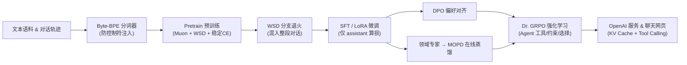

# 从零造一个“麻雀虽小五脏俱全”的大模型：学习与踩坑记录

> **项目仓库**：[github.com/zzfn/llm-lab](https://github.com/zzfn/llm-lab)
> **实验环境**：MacBook Pro（Apple M5，32GB 统一内存，PyTorch MPS 加速）
> **目标**：不依赖 `transformers` / `trl` 黑盒封装，用纯 PyTorch 从零手写并跑通现代大模型全链路，面向 **Agent 研发团队** 讲清“API 背后到底发生了什么”。

---

## 一、 为什么要做这个小仓库？（对比两个开源标杆）

在动手前先精读了两个极具代表性的开源项目，吸取了各自的精华：

1. **[logitcai/tinybrain](https://github.com/logitcai/tinybrain)**（偏前沿架构与全流程实验）
   - 亮点：`mHC` 多流残差、`Engram` 条件查表记忆、`3:1` 滑动窗口注意力、`MoE` 偏置均衡、`Muon` 优化器、`WSD` 分支退火、防 Softmax 塌缩稳定交叉熵、`MOPD` 多老师在线蒸馏、`Dr. GRPO`。
2. **[jingyaogong/minimind](https://github.com/jingyaogong/minimind)**（偏经典对齐谱系与工程生态）
   - 亮点：手写 `LoRA` 注入与无损合并、`DPO` 离线偏好对齐、`YaRN` 长文本 RoPE 外推、`<think>` 自适应思考开关与 OpenAI `reasoning_content` 接口。

最终我们决定做一个 **“麻雀虽小，五脏俱全”** 的实验仓 `llm-lab`：把模型压缩到 **1.91M ~ 22.93M**（本机 M5 几分钟就能跑完），但把上面两家几乎全部核心机制都用极简代码装了进来，并配上 **12 项单元测试** 验证数学等价性。

---

## 二、 整体技术全景图



---

## 三、 核心原理笔记（用 Agent 研发的语言讲透）

### 1. 分词器与 Prompt 注入防线（`src/tokenizer.py`）
- **为什么模型数不准 `"strawberry"` 有几个 `r`？**
  Byte-level BPE 先把文本拆成 UTF-8 字节（`0..255` 永不 `<unk>`），再贪心合并高频字节对。高频词根会被合并成单个整数 ID，模型根本看不到内部单字母。
- **为什么用户输入的 `<|im_start|>` 不会劫持对话？**
  普通用户输入与 `tool` 返回强制走 `allow_special=False`（`encode_ordinary`），控制符字符串会被拆成普通字节；只有系统拼接模板时才写入真正的控制符 ID。

### 2. 模型骨架与推理加速（`src/model.py`、`src/loss.py`）
- **Pre-Norm + RMSNorm**：去掉减均值操作、用 `float32` 算均方根，兼顾速度与深层稳定性。
- **RoPE + YaRN**：用二维旋转把绝对位置变成相对距离内积；YaRN 用高低频线性斜坡只压缩低频周期，实现长上下文外推。
- **GQA + KV Cache（为什么 Agent 多轮对话越往后越慢？）**：
  - Prefill 阶段并行计算全部历史（决定首字延迟 **TTFT**），Decode 阶段每步只喂 1 个新 token 并从 `KVCache` 读取全部历史 KV（决定生成速度 **TPOT**）。
  - GQA 让多个 Q 头共享一组 KV 头，直接按比例压缩 KV Cache 显存与访存带宽。
  - **本机 M5 实测（生成 128 token）**：`pico` 无缓存 `2161.4 ms (59.2 tok/s)` → 有缓存 **`518.1 ms (247.1 tok/s)`，提速 4.17x**；`nano` 无缓存 `743.3 ms` → 有缓存 **`238.0 ms`，提速 3.12x**。
- **`tinybrain` 三件套**：
  - **mHC**：4 条残差流 + 20 步对数域 `Sinkhorn` 把流间混合矩阵约束为双随机矩阵（行/列和均为 1，信号总量不爆炸不消失）。
  - **Engram**：2/3-gram 多头互异质数哈希查表，不占算力、只占显存，门控注入指定层。
  - **3:1 滑动窗口 + MoE**：局部窗口压缩长文计算量；MoE 用共享专家 + Top-K 路由 + 无梯度偏置均衡（在优化器步后更新，不破坏激活重计算）。
- **防 Softmax 塌缩（`src/loss.py`）**：高置信度下标准交叉熵正确项梯度下溢为 0、其余项残留梯度会被 Adam 放大。改用 `m = -LSE(z_j - z_t)`, `loss = softplus(-m)` 保持全词表梯度精确平衡。

### 3. 训练与对齐全家桶
- **Muon 优化器（`src/muon.py`）**：对 2D 权重矩阵动量做 5 步 Newton-Schulz 正交化，让各奇异值方向步长一致；1D 参数/词表/Engram 仍用 AdamW。
- **WSD 调度（`src/pretrain.py`）**：预热 + 恒定高原期 + `1 - sqrt(p)` 分支退火，训练中途随时拉分支即可验证或交付。
- **SFT Loss Mask & LoRA（`src/sft.py`、`src/lora.py`）**：
  - `system`、`user`、尤其是 **`tool` 返回内容** 的 target 全部设为 `-100`，只训练模型自己的回复、`<think>`、`<|tool_call|>` 与 `<|im_end|>`。
  - LoRA 通过 `B` 全零初始化保证初始增量为 0，训练后无损合并 `W + (B@A)*alpha/r` 实现零延迟推理（本机验证仅训练 **2.20%** 参数即可微调）。
- **对齐三剑客**：
  - **DPO（`src/dpo.py`）**：离线 `(chosen, rejected)` 偏好对优化，无需采样也无需 Reward Model（本机 10 步 `pref_acc` 达 100%）。
  - **MOPD（`src/distill.py`）**：学生在线生成，按领域路由给不同专家老师，算全词表精确反向 KL，解决离线蒸馏的暴露偏差。
  - **Dr. GRPO（`src/rl_grpo.py`）**：去掉 Critic、去掉组内 `std` 缩放、用常数 `N * max_new` 作分母消除长废话偏置；在 Agent 多轮循环里执行 `calc` 并把工具返回重新 mask 为 0。

---

## 四、 本机实战踩出来的 6 个经典深坑（干货复盘）

实际在浏览器和命令行跑通 8.95M `nano` 模型时，亲眼踩出了 6 个极有启发性的问题：

1. **坑 1：训练不够的基座模型“不会停下来”**
   - **现象**：Pretrain / 少步 SFT 后提问，模型答完后继续模仿语料往后无限接龙。
   - **原因**：模型还没学会在回答末尾输出 `<|im_end|>` 停止符。SFT 的 Loss Mask **必须把 `<|im_end|>` 保留为 1**。
2. **坑 2：GRPO 一度卡在 0% 或 28% 不涨分**
   - **现象**：最初设 `max_new=48`，模型第一轮 `<|tool_call|>...` 刚写到一半就被长度截断，工具没触发、整组奖励全是 0，`pg_loss=0.00000`。
   - **结论**：RLVR 必须保证 ① rollout 上限留足完整工具调用；② SFT 先让模型站上一定成功率（有正有负才有组内 Advantage 方差，否则梯度为 0）。
3. **坑 3：网页对话“第 1 轮正常，第 2 轮开始牛头不对马嘴，第 4 轮卡住”**
   - **现象**：只问 1 轮能准确答出定义；追问第 2 轮直接跑偏；第 4 轮输出半句直接中断。
   - **原因**：
     1. 最初 `sft.jsonl` 里全是单轮 QA，没有 `user1 → asst1 → user2 → asst2` 的多轮结构，模型根本没见过普通多轮追问（补入 500 条多轮样本后，连续 3 轮问答全部命中）；
     2. 8.95M 小模型对训练集没见过的问题（如 `1+1等于几`）没有 OOD 泛化能力；
     3. 到第 4 轮时累积历史逼近 `max_seq_len=512`，可用剩余空间 `room` 归零触发了安全截断——直观体会到为什么生产级 Agent 必须做上下文裁剪与摘要。
4. **坑 4：为什么单独输入计算题时，模型有时不调工具反而背起了自我介绍？**
   - **现象**：网页聊天没带 `system` 提示词，而训练数据里只有工具调用带了 `system`，模型靠“有没有 `system`”来路由分支。
   - **解法**：把所有 SFT/DPO/RL 样本统一挂载同一个 `SYSTEM_PROMPT`（`"你是 llm-lab 助手，必要时调用 calc(expr)。"`），实测同一个聊天框里连续输入“自我介绍 → `38 * 24` 计算 → KV Cache 问答”，模型能够自主切换直接回答与 `calc` 调用。
5. **坑 5：问 `1 * 0` 时，模型自己改写成了 `13 * 0`，工具返回 `0` 却答成了 `003`**
   - **现象**：输入 `请使用计算器计算 1 * 0`，模型调 `calc` 时参数写成 `"13 * 0"`，运行时返回 `0`，模型最终总结成 `003`。
   - **原因**：`data_gen.py` 中乘法只生成了 `11..49` 的两位数，工具结果也几乎全是 3~4 位数。模型从没见过个位数和 `0`，并没有真正理解“原样复制数字”，而是死记“乘号左边必须是两位数、结果必须是三位数”，属于典型的**分布偏移（OOD）导致的复制捷径失效**。
   - **对 Agent 工程的启示**：微调工具调用模型时，数据里必须专门覆盖 `0`、个位数、负数、空值、长数与异常返回等边界样本。
6. **坑 6：LoRA 增量保存时父目录不存在崩溃（`RuntimeError: Parent directory does not exist`）**
   - **现象**：在新目录 `--out out/sft_lora/ckpt.pt` 保存纯 LoRA 增量权重 `lora.pt` 时，`torch.save` 不会自动创建父目录而报错。
   - **修复**：在 `save_lora_only` 中补充 `path.parent.mkdir(parents=True, exist_ok=True)`，端到端验证通过。

---

## 五、 复现与演示命令清单

```bash
cd /Users/c.chen/wawa/llm-lab
source .venv/bin/activate

# 1. 验证全部 12 项核心单元测试（含 mHC/Engram/MoE/滑动窗口 KV Cache 等价性）
pytest -v

# 2. 启动本地网页与 OpenAI 兼容服务（http://127.0.0.1:8001/）
python -m src.serve out/dpo/ckpt.pt --port 8001

# 3. 命令行测多题型评测 & KV Cache 加速对比
python -m src.eval out/dpo/ckpt.pt
python -m src.generate --ckpt out/dpo/ckpt.pt --mode bench-cache
```
